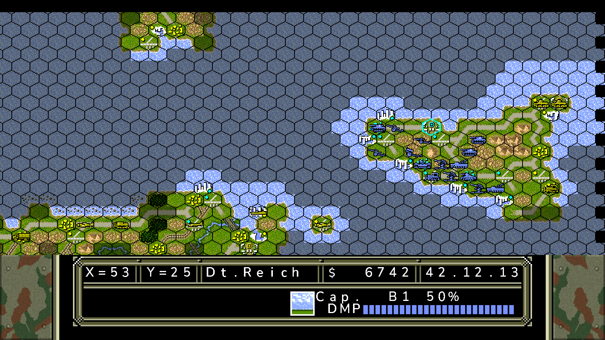
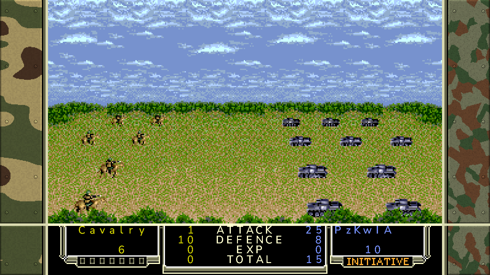
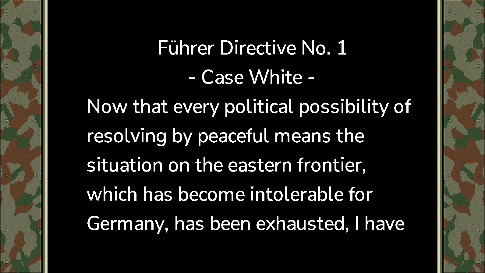

# Advanced Daisenryaku – native port and translation

*Advanced Daisenryaku: Deutsch Dengeki Sakusen* (Sega Mega Drive, 1991, released only in Japan)
as a native game for macOS and Windows, in English, German, French and Spanish.

Unofficial fan project. **No game data is included – you need your own ROM.**

| | |
|---|---|
|  |  |

## Features

- Runs natively on Apple silicon Macs and Windows x64, no emulator.
- Complete English translation: menus, unit and country names, campaign briefings and results,
  intro, epilogue. German, French and Spanish are translated from the English and not yet
  reviewed by native readers. The original Japanese is one menu row away.
- Sharp HD text in a modern typeface, 16:9 picture.
- Zoomed-out map that shows the whole width of the battlefield.
- Fast-forward, and automatic fast-forward during the enemy's turn.
- Campaign extras: last date for a great victory on the turn screen, campaign start in a later
  year, restart of the current map.

## Getting started

1. Download the zip for your system from the
   [Releases page](https://github.com/hexporter/advanced-daisenryaku/releases).
2. Have your dump of the **Japanese cartridge** ready (Japan, Rev A): 1,048,576 bytes,
   CRC32 `E0D5E18A`, an unzipped `.md` or `.bin` file. The game asks for it on the first start
   and applies the translation to a copy; your file is not changed.
3. **Mac** (Apple silicon, macOS 27.2 or newer): move `Advanced Daisenryaku.app` to
   Applications. The app is not notarized by Apple: the first time, right-click it → Open →
   Open.
   **Windows** (x64): unzip the folder and start `Advanced Daisenryaku.exe`. SmartScreen may
   ask once ("More info" → "Run anyway").

## Controls

| Xbox-style pad | Mega Drive button |
|---|---|
| X | A |
| A | B |
| B | C |
| Start | Start |

| Input | Effect |
|---|---|
| Right trigger | fast-forward (the further you press, the faster) |
| F9 | zoomed-out map on/off |
| F10 | HD text and tiles / original pixels |
| Esc, closing the window | quit (the game saves its battery memory) |

The layout can be changed in `settings.ini` in the data folder (below).

## Settings in the game

System menu → System:

- **Language** – English, Deutsch, Français, Español, 日本語. Until you choose one, the game
  follows your system language.
- **HD map** – the zoomed-out map on or off.
- **Fast enemy turn** and **Enemy battles** – how fast the computer's turn and its battles run.

Title menu: **CAMPAIGN START** picks the year the campaign begins in; **QUIT GAME** ends the
game. All settings are kept between launches.

## Your files

Save games and settings live in `~/Library/Application Support/Advanced Daisenryaku` (Mac) or
`%APPDATA%\Advanced Daisenryaku` (Windows):

| File | Contents |
|---|---|
| `ad-tr.srm` | save games (the cartridge's battery memory) – back this up |
| `settings.ini` | controls and display |
| `run.log` | messages of the last start – please attach it to bug reports |

## Problems and feedback

Please open an issue on the
[Issues page](https://github.com/hexporter/advanced-daisenryaku/issues) and attach `run.log`.

## Developers

Building from source, how the port works and how to contribute: [`DEVELOPMENT.md`](DEVELOPMENT.md).

## Licence and credits

Made with the static recompiler [segagenesisrecomp](https://github.com/mstan/segagenesisrecomp).
PolyForm Noncommercial 1.0.0 (`LICENSE`): free to use, change and share, not to sell. Details,
the typeface licence and credits: `NOTICE.md`. *Advanced Daisenryaku* is a trademark of its
owners; this project is not affiliated with or endorsed by them.
